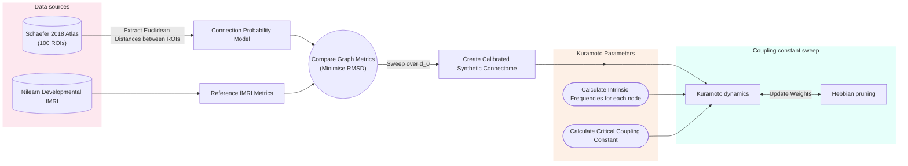

# 🧠 Kuramoto-Hebbian Style Pruning of Synthetic Connectomes
#### Simulating early neurodevelopmental pruning with Kuramoto Oscillators and Hebbian Plasticity.  

## 📝 Overview

**Motivation:**  
Early developmental stage fMRI data is limited. The project aims to calibrate a synthetic connectome, (using a probability of connection model that decays exponentially with distance between regions) and forces a fixed high density of the top 70% of connections to imitate highly dense infant connectomes.  
Followed by Kuramoto-Hebbian style pruning over a range of Kuramoto Coupling Strength values.  

**The Project Asks:**  
>❓Can a simplified Kuramoto model, alongside Hebbian-like pruning, reproduce early biological neurodevelopment in a synthetically generated connectome?  
>❓How does the Kuramoto Coupling Strength affect the graph metrics of the resulting connectomes?  
>❓Can the resulting connectomes be classified into Autistic (ASD), Neurotypical (NT) and Schizophrenic (SZ) characteristic connectomes?  

❗It is intended to explore how a single control parameter (coupling strength K) changes network organisation, which may inform how future, more realistic models are designed.

## Flow Chart 

## Model Decisions
### Connectome Generation
$$
P_{ij} = A \exp\left(-\frac{D_{ij}}{d_0}\right)
$$

- $D_{ij}$: Euclidean distance between regions $i$ and $j$
- $d_0$: spatial scale of the distance cost, fitted by sweeping over a range of values
- $A$: fixed scaling factor (`scaling_factor = 10` in `config.py`)
[[1]](#1)

### Kuramoto Equation
$$
\frac{d \theta_i}{dx} = E\omega_i + K\sum_{j=0}^{N}B_{ij}W_{ij}\sin(\theta_j - \theta_i) 
$$
[[2]](#2)

### Coupling Constant
 $K_c = \sigma \sqrt{8 / \pi} / \lambda_{max}$
 

## Configuration Decisions
 
 

 
Connectome generation Parameters

  
 | Parameter | Value | Justification | Source |
 | :--- | :--- | :--- | :--- |
 | n_rois | 100 | Memory | Schaefer et al. 2018 [[3]](#3) |
 | seed | 10 | Reproducibility | none |
 |scaling_factor | 10.0 | Representative of many strong connections in the early connectome. | none |    
 |noise_loc, noise_scale | 0.05, 0.05 | Small noise to replicate biological noise | none |
 | d0_range | 0-19 | Typical Value is 5-15 for region to region in humans.|  [[4]](#4)|
 | threshold_percent | 30 | Keeps top 70% of edges, dense to represent unpruned network | none |

 

  

  
Kuramoto Parameters

    
  | Parameter | Value | Justification | Source |
  | :--- | :--- | :--- | :--- |
  |dt | 0.01 | Integration Step| Convergence test |
  |eta| 5e-4 | Learning Rate | none |
  |time_steps| 2000 | Running for 2 years | 1000 time-steps is approx 1 year between ages 1-2years |
  |w_min| 0.1| Pruning threshold | none |
  | record_each| 100 | Storage - to be used to show the dynamic pruning| none |
  |sync_reward, desync penalty| 0.5 | phase synchronisation is rewarded half as much as desynchronisation is penalised to mitigate random hubs forming due to noise|
  |intrinsic_frequency_effect | 5 | Modelling choice to promote hubs forming | none |

  

   

   
Intrinsic Frequency Parameters

  
   | Parameter | Value | Justification | Source |
   | :--- | :--- | :--- | :--- |
   |alpha_max, alpha_min| 12.0, 8.0| Alpha range band|  [[5]](#5) |
   |node_strength_proportion | 0.5 | The amount that the node strengths affect the intrinsic frequencies of each region i.e. hubs will have higher node strengths and therefore a stronger "pull" (intrinsic frequency) | Modelling choice|

   

   

   
Coupling Constant Parameters

    
   | Parameter | Value | Justification | Source |
   | :--- | :--- | :--- | :--- |
   |sigma | (alpha_max - alpha_min)*2*np.pi / np.sqrt(12) | std for alpha frequency range| none |
   |k_max_factor | 3.0 | Sweep of k goes up to k_max_factor*K_c| none |
   |number_of_k_values | 25 | Resolution of K sweep| none |
   
   

   ## References
   [1] Ercsey-Ravasz M, Markov NT, Lamy C, Van Essen DC, Knoblauch K, Toroczkai Z, Kennedy H. A predictive network model of cerebral cortical connectivity based on a distance rule. Neuron. 2013 Oct 2;80(1):184-97. doi: 10.1016/j.neuron.2013.07.036. Epub 2013 Oct 2. PMID: 24094111; PMCID: PMC3954498.
   
   [2] https://www.math.nagoya-u.ac.jp/~richard/teaching/f2025/SML_Harumi.pdf

   [3] https://nilearn.github.io/dev/modules/generated/nilearn.datasets.fetch_atlas_schaefer_2018.html

   [4] Cirunay, Michelle & Ódor, Géza & Papp, István & Deco, Gustavo. (2025). Scale-free behavior of weight distributions of connectomes. Physical Review Research. 7. 10.1103/PhysRevResearch.7.013134. 
   
   [5] ref:https://www.sciencedirect.com/topics/medicine-and-dentistry/alpha-wave

   
