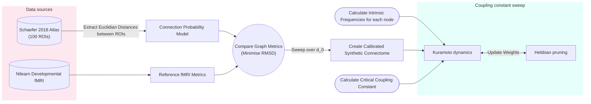

# CC Pruning 
Description

## Flow Chart 

## Model Decisions
### Connectome Generation
$$
P_{ij} = A \exp\left(-\frac{D_{ij}}{d_0}\right)
$$

- $D_{ij}$: Euclidean distance between regions $i$ and $j$
- $d_0$: spatial scale of the distance cost, fitted by sweeping over a range of values
- $A$: fixed scaling factor (`scaling_factor = 10` in `config.py`)

### Kuramoto Equation
# NOTE USE THE IPYNB TO ADD TO README ALSO LOOK THROUGH PAPER NOTEBOOK

### Coupling Constant
 $K_c = \sigma \sqrt{8 / \pi} / \lambda_{max}$
 

## Configuration Decisions
 
 

 
Connectome generation Parameters

  
 | Parameter | Value | Justification | Source |
 | :--- | :--- | :--- | :--- |
 | n_rois | 100 | Memory | Schaefer et al. 2018 |
 | seed | 10 | Repreoducability | none |
 |scaling_factor | 10.0 | Normalisation of Connection Probability |  |    
 |noise_loc, noise_scale | 0.05, 0.05 | Small noise to replicate biological noise |  |
 | d0_range | 0-19 | Typical Value is 5-15 |  |
 |threshold_percent | 30??? | NEED TO JUSTIFY| |

 

  

  
Kuramoto Parameters

    
  | Parameter | Value | Justification | Source |
  | :--- | :--- | :--- | :--- |
  |dt | 0.01 | Integration Step| Convergence test |
  |eta| 5e-4 | Learning Rate | |
  |time_steps| 2000 | Running for 2 years | 1000 time-steps is approx 1 year between ages 1-2years |
  |w_min| 0.1| Pruning threshold | |
  |record_each| 100 | Storage - to be used to show the dynamic pruning| |
  |sync_reward, desync penalty| 0.5 | phase synchronisation is rewarded half as much as desynchronisation is    penalised to mitigate random hubs forming due to noise|

  

   

   
Intrinsic Frequency Parameters

  
   | Parameter | Value | Justification | Source |
   | :--- | :--- | :--- | :--- |
   |alpha_max, alpha_min| 12.0, 8.0| Alpha ramge band|  ref:https://www.sciencedirect.com/topics/medicine-and-dentistry/alpha-wave |
   |node_strength_proportion | 0.5 | The amount that the node strengths affect the intrinsic frequencies of each region i.e. hubs will have higher node strengths and therefore a stronger "pull" (intrinsic frequency) | Modelling choice|

   

   

   
Coupling Constant SweepCoupling Constant Sweep Parameters

    
   | Parameter | Value | Justification | Source |
   | :--- | :--- | :--- | :--- |
   |sigma | (alpha_max - alpha_min)*2*np.pi / np.sqrt(alpha_max) | std for alpha frequency range| |
   |k_max_factor | 10.0 | Sweep of k goes up to k_max_factor*K_c| |
   |number_of_k_values | 25 | Resolution of K sweep| |
   
   

